

  

<h1 align="center">Jhonatan Rossi</h1>

  Estudante de Banco de Dados · Fatec São José dos Campos 
  Técnico em Desenvolvimento de Sistemas · ETEC Machado de Assis 
  <b>Em busca da minha primeira oportunidade na área de tecnologia</b>

  
  

  <a href="#sobre-mim">Sobre mim</a> ·
  <a href="#principais-conhecimentos">Conhecimentos</a> ·
  <a href="#projeto-ipem-control">Projeto</a> ·
  <a href="#contribuições-pessoais">Contribuições</a> ·
  <a href="#hard-skills">Hard Skills</a> ·
  <a href="#soft-skills">Soft Skills</a> ·
  <a href="#aprendizados">Aprendizados</a>

---

## Sobre mim

Sou formado como **Técnico em Desenvolvimento de Sistemas pela ETEC Machado de Assis** e hoje curso **Banco de Dados na Fatec São José dos Campos**. Gosto de entender um sistema de ponta a ponta: da modelagem das tabelas até a tela que o usuário final vai usar.

No **IPEM Control**, projeto do 3º semestre apresentado a seguir, atuei como desenvolvedor full stack. Modelei o banco de dados, construí telas do front-end e implementei a segurança do back-end com **Spring Security e JWT**.

Em paralelo à faculdade, sigo uma trilha de estudos própria em **Java back-end**, do Java puro ao Spring Boot, Docker e cloud.

Estou **em busca da minha primeira oportunidade na área de tecnologia**, onde eu possa aplicar o que aprendi, contribuir com o time e continuar evoluindo, principalmente em back-end e banco de dados.

## Principais conhecimentos

| Área | Tecnologias |
|:--|:--|
| **Back-end** |     |
| **Banco de Dados** |   |
| **Front-end** |    |
| **Ferramentas** |     |

---

## Projeto: IPEM Control

  

<i>Sistema web de controle e análise de abastecimento das viaturas do IPEM-SP</i>

<table>
  <tr><td><b>Período</b></td><td>3º semestre · 2026/1 (16/03 a 31/05, apresentado na Feira de Soluções em 11/06/2026)</td></tr>
  <tr><td><b>Empresa parceira</b></td><td>IPEM-SP · Regional São José dos Campos</td></tr>
  <tr><td><b>Equipe</b></td><td>SquadTech · 8 integrantes</td></tr>
  <tr><td><b>Metodologia</b></td><td>Scrum · 3 sprints de 3 semanas</td></tr>
  <tr><td><b>Meu papel</b></td><td>Desenvolvedor full stack e responsável pela modelagem do banco de dados</td></tr>
  <tr><td><b>Repositórios</b></td><td>
    
    
    
  </td></tr>
  <tr><td><b>Demonstração</b></td><td></td></tr>
</table>

### O problema

O controle de abastecimento das viaturas da Regional de São José dos Campos era **feito em papel**. Cada condutor anotava quilometragem, litros, valor abastecido e sua identificação em uma prancheta mantida dentro do veículo. No fim do mês, o Diretor da unidade precisava reunir todas as folhas, conferir uma a uma e consolidar os dados para depois digitá-los no **SGI**, o sistema oficial do instituto.

Esse fluxo tornava difícil comparar viaturas, acompanhar o consumo médio de combustível e identificar inconsistências a tempo.

### A solução

Uma aplicação web em que o **técnico registra tudo pelo celular** no momento em que acontece e o **administrador valida, analisa e consolida** os dados em poucos cliques.

| | Antes | Com o IPEM Control |
|:--|:--|:--|
| **Registro** | Prancheta física em cada viatura | Formulário digital com validações |
| **Conferência** | Diretor confere folha por folha | Painel do administrador com edição auditada |
| **Consumo** | Cálculo manual | KM rodado e consumo calculados automaticamente |
| **Inconsistências** | Difíceis de perceber | Travas: hodômetro menor que o último registro, viatura com saída em aberto |
| **Consolidação mensal** | Soma manual de todas as folhas | Relatórios prontos, com exportação em PDF, Excel e CSV |

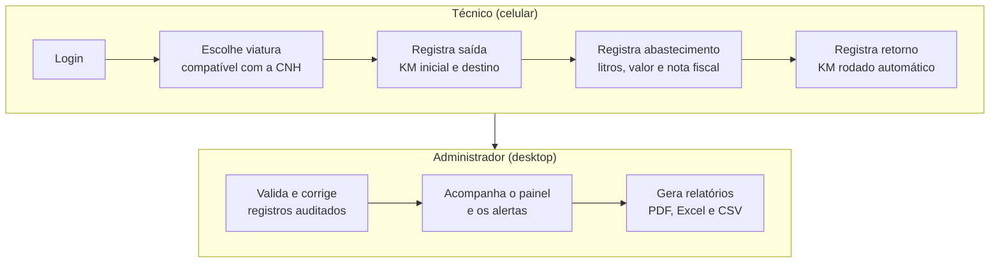

  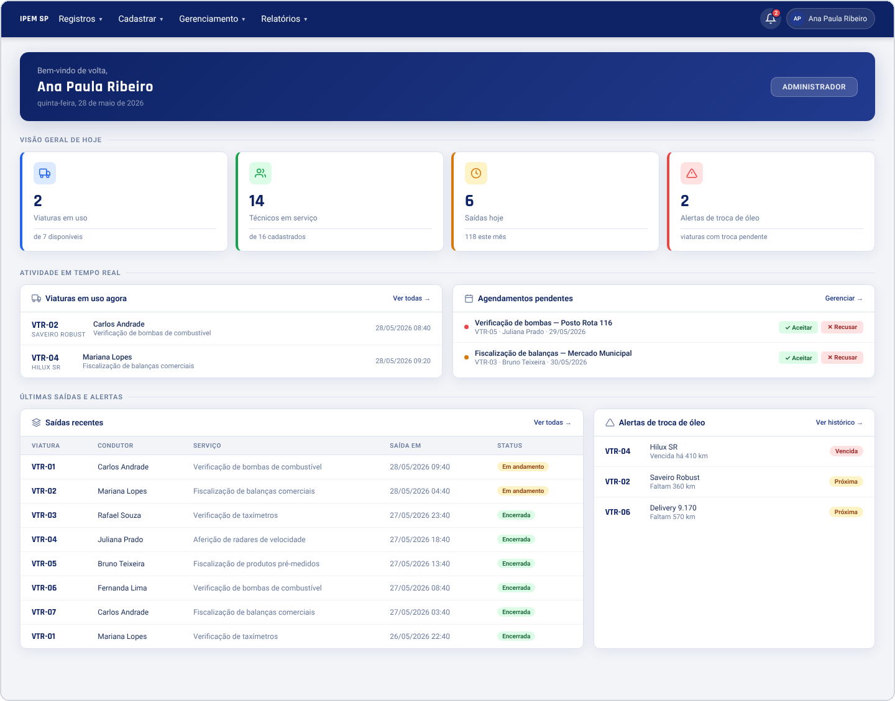
   Painel do administrador na versão final do sistema 

### Funcionalidades

| Técnico | Administrador |
|:--|:--|
| Vê apenas as viaturas que sua CNH permite conduzir | Cadastra viaturas, usuários, tipos de serviço e de combustível |
| Registra saída, retorno e abastecimento | Acompanha o painel com viaturas em uso, saídas e alertas |
| Agenda o uso de uma viatura | Aprova ou recusa agendamentos, com motivo obrigatório na recusa |
| Consulta o histórico de uso das viaturas | Gera relatórios de abastecimento, viaturas e técnicos, com exportação em PDF, Excel e CSV |
| Recebe notificações (agendamento aprovado ou recusado, avisos) | Recebe alertas de troca de óleo por quilometragem |
| Edita o próprio perfil e troca a senha | Corrige registros com trilha de auditoria (quem alterou, o quê e quando) |

### Arquitetura

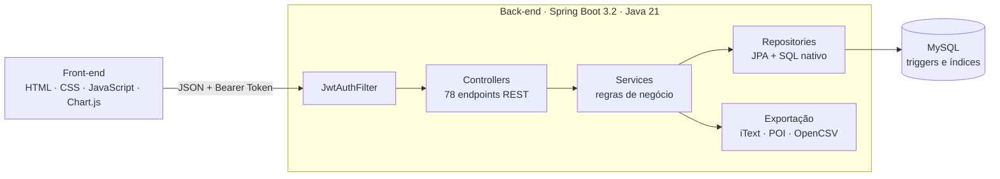

### Tecnologias utilizadas

| Camada | Tecnologias |
|:--|:--|
| **Back-end** |        |
| **Banco de Dados** |  |
| **Front-end** |     |
| **Relatórios** | -000000?style=for-the-badge) -000000?style=for-the-badge)  |
| **Ferramentas e gestão** |       |

---

## Contribuições pessoais

Participei das três sprints, passando por banco de dados, front-end e back-end. Todas as tasks abaixo estão registradas nos documentos de rastreabilidade de cada sprint ([Sprint 1](https://github.com/SquadTech-API/API-3/blob/main/docs_por_Sprint/docs_1_Sprint/Mapeamento_1_Sprint) · [Sprint 2](https://github.com/SquadTech-API/API-3/blob/main/docs_por_Sprint/docs_2_Sprint/Mapeamento_2_Sprint) · [Sprint 3](https://github.com/SquadTech-API/API-3/blob/main/docs_por_Sprint/docs_3_Sprint/Mapeamento_3_Sprint)) e nos meus commits ([front-end](https://github.com/SquadTech-API/API3_FRONTEND/commits/main/?author=JhowRossii) · [back-end](https://github.com/SquadTech-API/API3_BACKEND/commits/Sprint-3/?author=JhowRossii)).

| Sprint | Banco de Dados | Front-end | Back-end |
|:--:|:--|:--|:--|
| **1** | Requisitos, DER, modelo lógico e scripts SQL | Login, viaturas, saída, retorno e abastecimento | Ajustes de integração com o front |
| **2** | — | Histórico de abastecimentos, relatório por técnico, alerta de KM e tipos de serviço | Ajustes nos relatórios |
| **3** | — | Perfil, agendamentos, combustíveis, troca de óleo, edição de registros e auditoria | Segurança com JWT, mensagens de erro e reestruturação do back-end |

<b>Modelagem do banco de dados</b> · Sprint 1

 

Fiquei responsável por toda a base de dados do projeto. Comecei pelo levantamento das informações que o sistema precisava guardar (viaturas, usuários, saídas, abastecimentos, trocas de óleo e documentos), depois desenhei o **DER**, montei o **modelo lógico** com as 9 tabelas e seus relacionamentos e, por fim, escrevi os **scripts SQL** que criam o banco.

  

Além de guardar os dados, o banco foi pensado para **proteger as regras de negócio**. Assim, mesmo que alguém tente gravar um dado errado por fora da aplicação, o próprio banco recusa:

| Regra | Como o banco garante |
|:--|:--|
| Uma viatura não pode ter duas saídas abertas ao mesmo tempo | Trigger que bloqueia a nova saída enquanto a anterior não tiver retorno |
| O KM de retorno não pode ser menor que o de saída | Restrição de verificação (`CHECK`) na tabela de saídas |
| Litros e valor do abastecimento precisam ser positivos | Restrições de verificação na tabela de abastecimentos |
| Placa, CPF, e-mail e número da CNH não se repetem | Restrições de unicidade (`UNIQUE`) |
| Uma viatura com histórico não pode ser apagada | Chaves estrangeiras que impedem a exclusão de registros ligados |
| Relatórios por data e por viatura respondem rápido | Índices nas colunas mais consultadas |

[Ver o script completo do banco](https://github.com/SquadTech-API/API-3/blob/main/docs_BD/modelo_Fisico/IPEM_Control_modelo_fisico.sql)

<b>Telas do técnico no celular</b> · Sprint 1

 

Desenvolvi o fluxo principal do técnico, pensado para ser usado no celular, dentro da viatura: **login**, **seleção de viaturas**, **nova saída**, **registro de retorno** e **abastecimento**. Todas as telas são responsivas e validam os campos antes de enviar (litros, data, viatura e quilometragem), evitando que dados incorretos cheguem ao banco.

  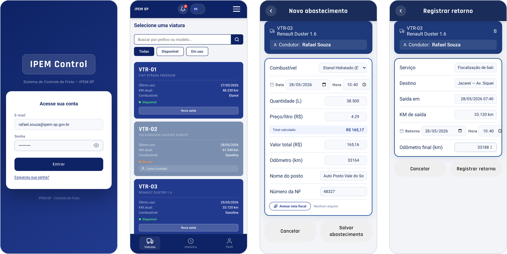
   Login · Seleção de viaturas · Abastecimento · Registro de retorno

Um detalhe importante é que a lista de viaturas **respeita a categoria da CNH** de quem está logado. No exemplo, o técnico tem CNH B, então os caminhões VTR-06 e VTR-07, que exigem categoria C, nem aparecem na lista dele. Essa regra fica em uma função compartilhada, usada tanto na lista de viaturas quanto na escolha do segundo condutor de uma saída.

Também fiz os ajustes necessários no back-end para que essas telas se comunicassem corretamente com a API.

<b>Relatórios e telas administrativas</b> · Sprint 2

 

Nesta sprint passei para o lado do administrador, com telas focadas em **acompanhar o consumo e validar os registros** antes da consolidação mensal.

| Tela | O que faz |
|:--|:--|
| **Histórico de abastecimentos** | Lista completa com filtros e cards que resumem o padrão de consumo da frota |
| **Relatório por técnico** | Atividades de cada técnico no período, para conferir os registros antes do fechamento do mês |
| **Alerta de troca de óleo** | Aviso em destaque quando uma viatura se aproxima (ou passa) do KM da próxima troca |
| **Tipos de serviço e ordens** | Cadastro de ordens de serviço com a seleção das viaturas de cada uma |

  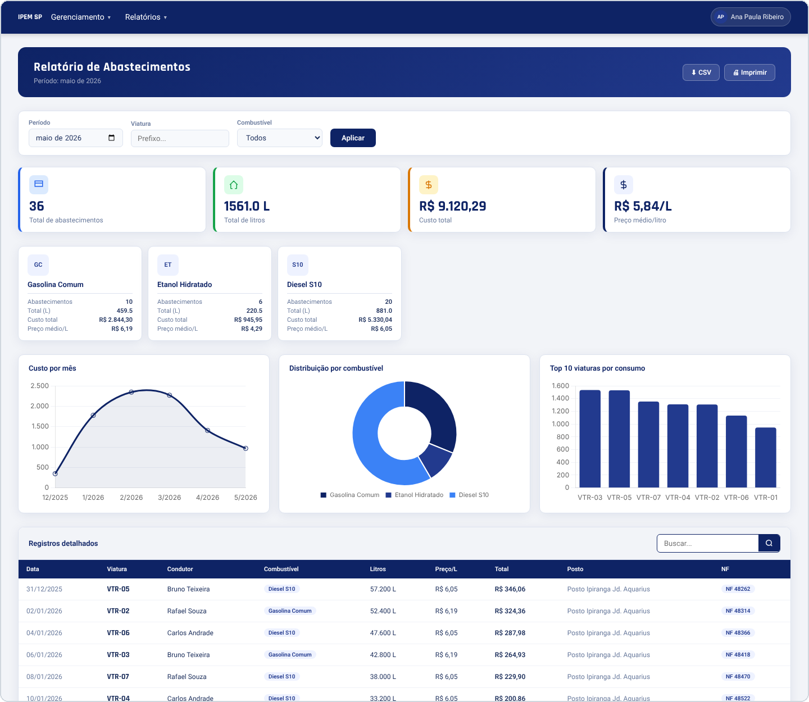
   Relatório de abastecimentos

  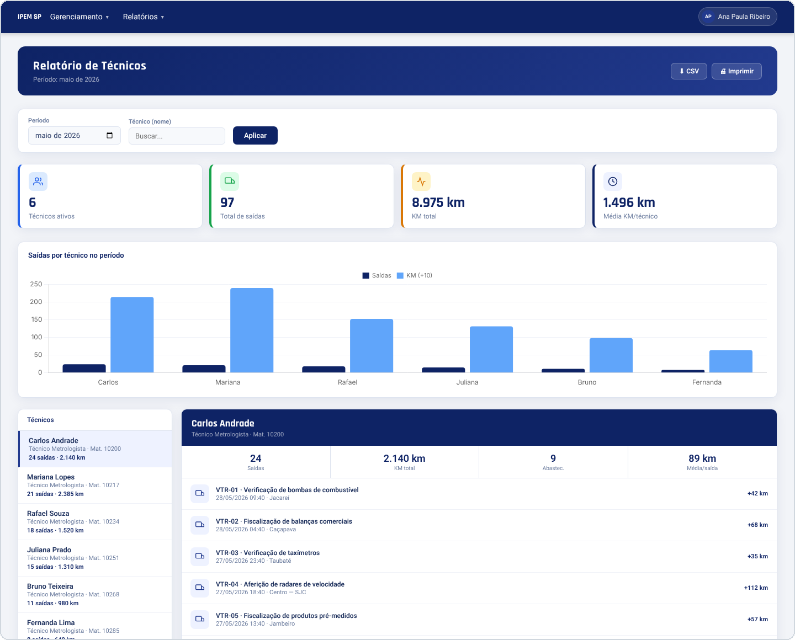
   Relatório por técnico

  
   Alerta de troca de óleo no painel

Também criei a **base compartilhada do front-end**: um conjunto de funções que todas as telas usam (controle de sessão e perfil, janelas de aviso, formatação de valores em reais, quilômetros e datas, além da regra da CNH), o cabeçalho padrão e o layout de desktop do administrador. Com isso, cada tela nova passou a nascer com o mesmo visual e comportamento, sem repetir código.

<b>Segurança: login com Spring Security e JWT</b> · Sprint 3

 

Implementei a camada de autenticação e autorização do back-end. Quando o usuário faz login, a API confere a senha (guardada de forma criptografada com **BCrypt**) e devolve um **token JWT**, uma espécie de crachá digital válido por 24 horas. A partir daí, toda requisição apresenta esse crachá, e a API decide o que aquela pessoa pode acessar:

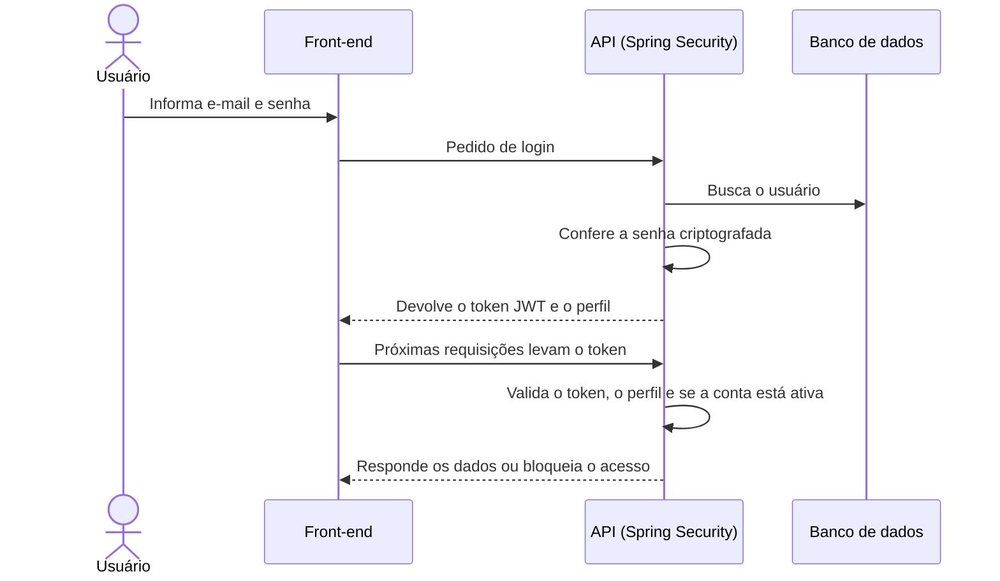

Na prática, isso garante três coisas: **ninguém acessa a API sem login**, **técnicos não conseguem abrir rotas exclusivas do administrador** (painel, relatórios e auditoria) e **uma conta desativada perde o acesso na hora**, mesmo que ainda tenha um token válido.

<b>Mensagens de erro claras para o usuário</b> · Sprint 3

 

Centralizei o tratamento de erros da API em um único ponto. Antes, um problema no banco chegava à tela como um erro técnico e genérico. Depois da mudança, cada situação devolve o código HTTP correto e uma **mensagem em português** que o front-end mostra direto para o usuário:

| Situação | O que o usuário vê |
|:--|:--|
| CPF que já existe | "CPF já cadastrado no sistema." |
| Placa repetida | "Placa já cadastrada no sistema." |
| Número de CNH repetido | "Número de habilitação já cadastrado." |
| Campo obrigatório vazio ou inválido | "Dados inválidos", indicando qual campo corrigir |
| Registro que não existe mais | Aviso de que o item não foi encontrado |
| Regra de negócio violada | A explicação da regra (por exemplo, KM menor que o anterior) |

<b>Reestruturação do back-end e novas funcionalidades</b> · Sprint 3

 

Na reta final do projeto, reorganizei o back-end camada por camada (**entidades, repositórios, serviços, controllers e DTOs**), padronizando todo o código em inglês e deixando cada parte com uma responsabilidade clara. Isso facilitou a integração com o front-end e a manutenção pela equipe.

Junto com a Giovanna e o João, implementei no back-end as funcionalidades novas da sprint:

- **Perfil do usuário:** edição dos próprios dados e troca de senha, sem expor campos que só o administrador pode alterar;
- **Agendamentos:** o técnico solicita uma viatura e o administrador aprova ou recusa, com notificação automática;
- **Tipos de combustível:** cadastro completo, com preço por litro e status ativo ou inativo;
- **Notificações:** avisos de agendamento aprovado ou recusado e de troca de óleo, com marcação de lidas;
- **Troca de óleo:** registro vinculado a uma saída, com cálculo automático do KM da próxima troca;
- **Auditoria:** toda edição feita pelo administrador grava quem alterou, o quê e quando.

Também reescrevi as **consultas dos relatórios** diretamente em SQL, para calcular no banco indicadores como KM rodado por técnico, tempo médio de uso das viaturas e destinos mais frequentes.

<b>Telas de gestão, agendamentos e auditoria</b> · Sprint 3

 

| Tela | O que faz |
|:--|:--|
| **Agendamentos** | O técnico solicita o uso de uma viatura e acompanha o status; o administrador aprova ou recusa |
| **Meu perfil** | Exibe os dados do usuário, permite trocar a senha e sair com confirmação |
| **Troca de óleo** | Registro vinculado a uma saída, mostrando na hora o KM da próxima troca |
| **Tipos de combustível** | Cadastro com nome, sigla, categoria, preço por litro e status |
| **Histórico de trocas** | Situação de cada viatura, com barra de progresso até a próxima troca |
| **Edição de registros** | Correção de saídas, abastecimentos e trocas pelo administrador, com aviso de auditoria |
| **Log de auditoria** | Quem alterou o quê e quando, com filtros por usuário, ação e período |

  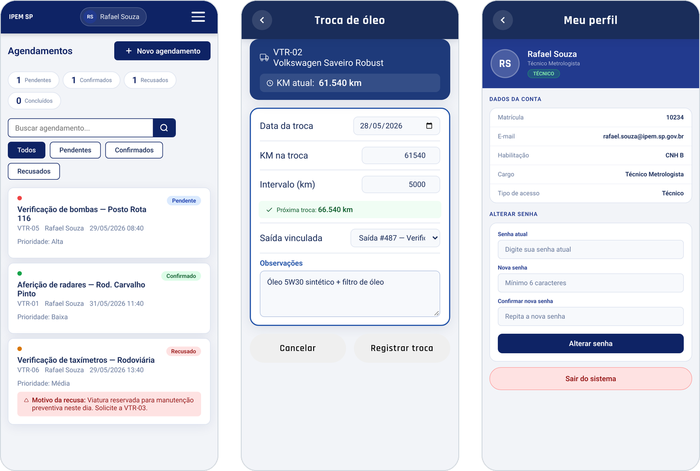
   Agendamentos (visão do técnico) · Troca de óleo · Meu perfil

O agendamento segue um fluxo simples. Quando o administrador recusa um pedido, o **motivo é obrigatório** e chega ao técnico como notificação, destacado em vermelho:

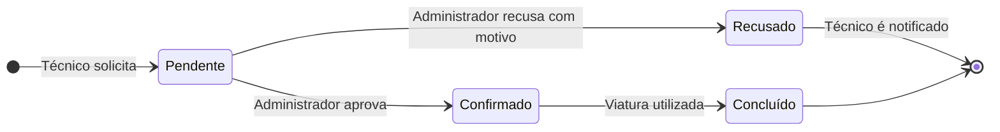

  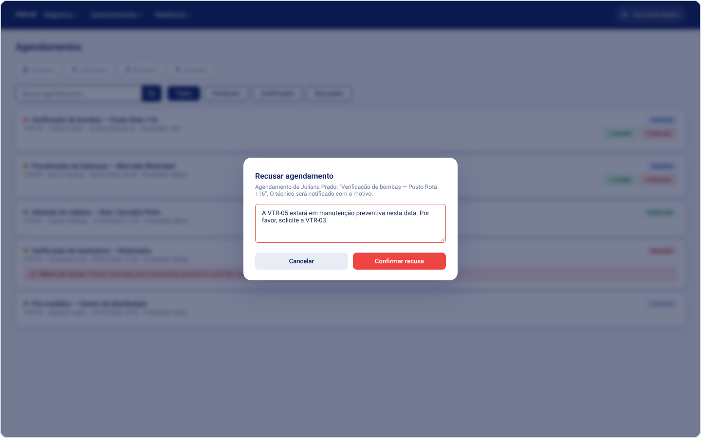
   Recusa de agendamento com motivo obrigatório

  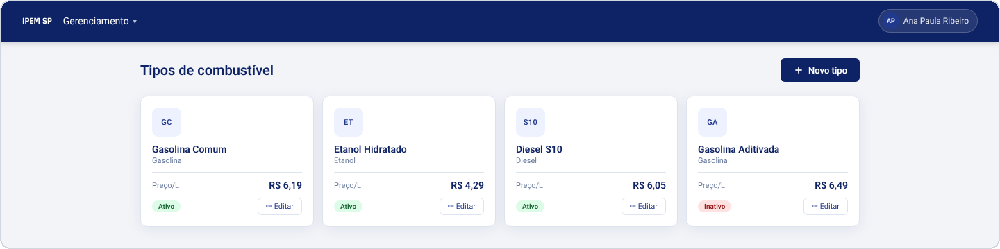
   Tipos de combustível

  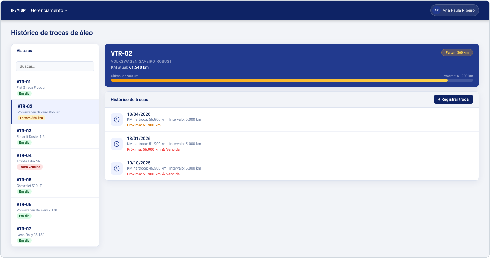
   Histórico de trocas de óleo

  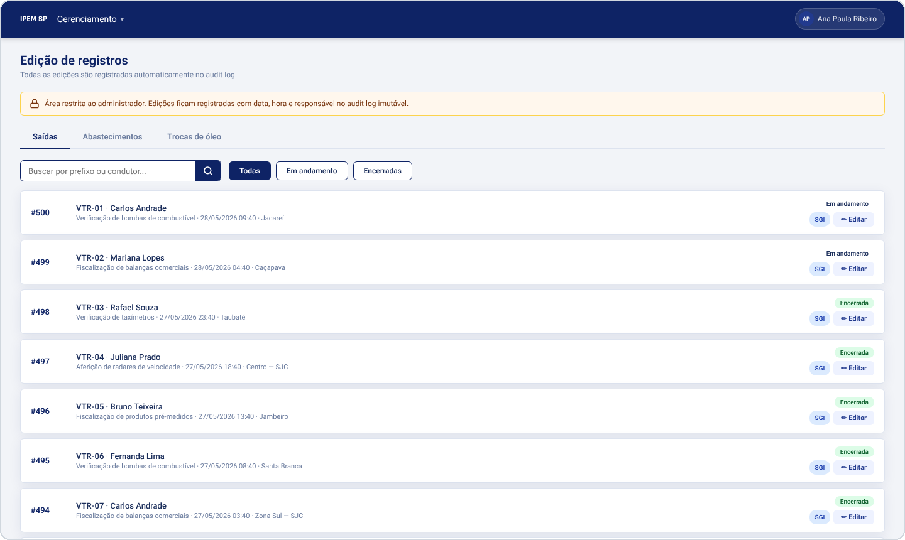
   Edição de registros pelo administrador

  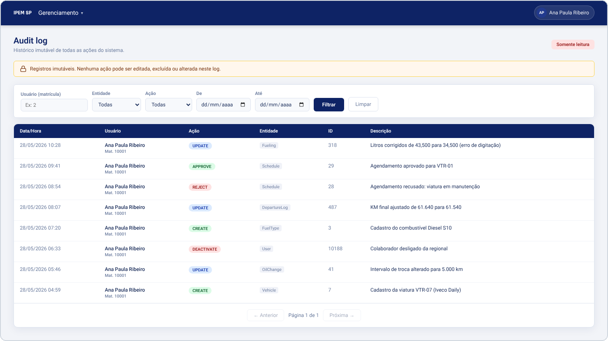
   Log de auditoria

---

## Hard Skills

| Tecnologia | Nível de proficiência | Onde apliquei no projeto |
|:--|:--|:--|
| **Java** | Sei fazer com autonomia | Serviços, DTOs e regras de negócio da API |
| **Spring Boot** | Sei fazer com autonomia | Controllers, serviços e injeção de dependências |
| **Spring Security + JWT** | Sei fazer com ajuda | Login, proteção das rotas e controle de acesso por perfil |
| **JPA / Hibernate** | Sei fazer com autonomia | Mapeamento das entidades e consultas ao banco |
| **SQL / MySQL** | Sei fazer com autonomia | Criação das tabelas, triggers, índices e consultas dos relatórios |
| **Modelagem de dados** | Sei fazer com autonomia | DER e modelo lógico do sistema |
| **HTML e CSS** | Sei fazer com autonomia | Telas responsivas do técnico e do administrador |
| **JavaScript** | Sei fazer com autonomia | Comunicação com a API, validações e telas dinâmicas |
| **Git e GitHub** | Sei fazer com autonomia | Branches por task, pull requests e padrão de commits |

## Soft Skills

| Competência | Como apareceu no projeto |
|:--|:--|
| **Comunicação** | Fui ponte entre front-end e back-end, alinhando o formato dos dados para que as telas integrassem sem retrabalho |
| **Proatividade** | Na última sprint assumi a segurança com JWT e a reestruturação do back-end para garantir a entrega final |
| **Resolução de problemas** | Investiguei e corrigi falhas de integração, como o Spring Security bloqueando requisições e conflitos de configuração entre scripts do front |
| **Trabalho em equipe** | Dividi histórias em dupla e em trio na Sprint 3 e apoiei colegas nas integrações |
| **Organização** | Commits padronizados com o código de cada task (`#T03`, `#A12`...), mantendo a rastreabilidade exigida pelo Scrum |

## Aprendizados

- **Modelar antes de codar economiza tempo.** Como o banco foi a primeira entrega, as histórias seguintes já tinham uma base sólida para crescer.
- **Regra de negócio importante também mora no banco.** Travas como a de saída aberta garantem a consistência dos dados independentemente de quem grava.
- **Segurança e padronização desde o início.** Implementar JWT e padronizar nomes só na Sprint 3 exigiu reorganizar várias camadas, algo que planejaria desde a Sprint 1 em um próximo projeto.
- **Rastreabilidade faz diferença.** Vincular cada commit a uma task facilitou revisões, sprint reviews e a escrita deste próprio portfólio.

---

  Fatec São José dos Campos · Banco de Dados · Metodologia da Pesquisa Científico-Tecnológica

